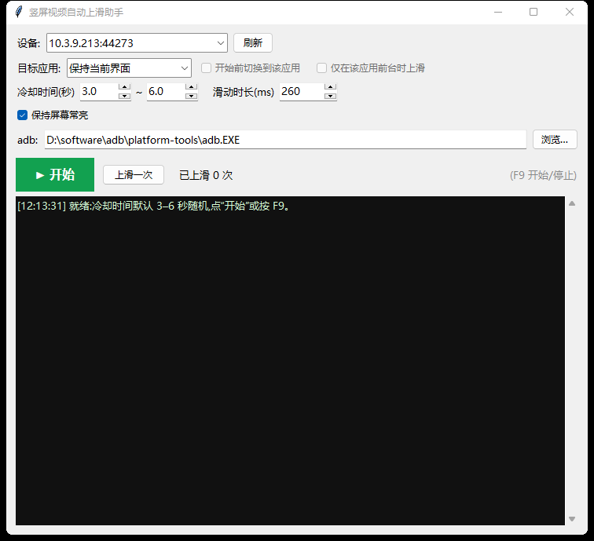

# 竖屏视频自动上滑助手

通过 ADB 给手机发"上滑"手势,自动一条条往下刷竖屏视频。**默认冷却时间 3–6 秒随机**:每次滑完重新抽一个值,不会是死板的固定节拍。

不绑定某个 App——抖音、拼多多(多多视频)、哔哩哔哩竖屏、快手、小红书……凡是"上滑换下一条"的界面都适用。想限定只在某个 App 里滑,界面上选一下即可。

三种模式:

| 模式 | 干什么 |
| --- | --- |
| **纯滑动**(默认) | 按冷却时间定时上滑,不看画面 |
| **多多视频金币任务** | 看画面认页面:自动做「看商品视频 / 看直播 / 喝水打卡」,只在右上角有倒计时气泡时才滑,完成后返回 |
| **多多视频挂机** | **不进金币页、不做任务**,直接退回视频流按间隔一条条刷;你点进别的页面它就待机不动,回到视频流自动接着刷 |

> 金币任务和挂机用的模板、按钮坐标、页面结构全是拼多多家的,所以**这两个模式只在「目标应用」选到「拼多多·多多视频」时才出现在界面上**;选成别的 App 会自动退回纯滑动,免得拿拼多多的坐标去点抖音的界面。
>
> 两者是同一个执行器的两档:金币任务跑完模块后本来也会自动进挂机;「多多视频挂机」只是跳过任务那一段直接开始刷。



## 环境要求

- Windows + Python 3(带 tkinter,官方安装包默认自带)
- 电脑上已装 adb(Platform-Tools),手机已开启「USB 调试」或「无线调试」并授权
- 本机已验证:`D:\software\adb\platform-tools\adb.exe`;旧机 realme RMX3800(1264×2780)、新机 Sony J8110 / Xperia 1(1096×2560,21:9)两台都能用

### conda 环境 `Scroller`

本机用 conda 环境 **`Scroller`**(Python 3.13)运行,图形界面和金币任务模式都跑在这个环境里。**环境目录挪过一次**,现在是 `E:\CondaData\envs\Scroller`(早期的 `C:\Users\<你>\.conda\envs\Scroller` 已不存在,`启动助手.bat` 里两处路径都跟着更新了):

```powershell
conda activate Scroller
python -m pip install -r requirements.txt   # numpy + opencv-python-headless,已装可跳过
python vertical_swiper.py
```

纯滑动模式只用标准库 + tkinter;金币任务模式的图像识别需要 `numpy` 和 `opencv-python-headless`。

### 项目自带的 GPU 环境 `env_gpu`

训练判页小网络、或者想用显卡推理时,直接拿它当解释器即可(它是从你的 conda 环境 `myTorch` 克隆出来的独立环境,torch 2.5.1+cu121 + cv2 + onnx):

```powershell
.\env_gpu\python.exe -c "import torch;print(torch.cuda.is_available(), torch.cuda.get_device_name(0))"
.\env_gpu\python.exe vertical_swiper.py --cli --mode idle
```

平时跑软件用 `Scroller` 就够了,两条路的识别结果一致(ONNX 与 torch 的输出误差 1.4e-06)。

## 启动

双击 **`启动助手.bat`**,或 `python vertical_swiper.py`。点「▶ 开始」或按 **F9** 开始,再按 F9 停止。

双击时批处理会**优先用 conda 环境 `Scroller`**,找不到再退回项目内的 `venv`,最后才找系统 Python;找到后用同一套 Python 旁边的 `pythonw.exe` 无窗口启动。想看到控制台输出或传参数,就在 cmd/PowerShell 里带参数运行:

```bat
启动助手.bat --dry-run          :: 只打印坐标,不动手机
启动助手.bat --cli --app pdd    :: 命令行模式
```

## 冷却时间

界面上是一个区间:**从 [3.0] 到 [6.0] 秒**,每轮上滑后在区间内均匀抽一个随机值作为这次的冷却时间。

- 想让节奏更慢:改成 `5 ~ 12`
- 想固定节拍:两端填一样的数,例如 `5 ~ 5`
- 运行中直接改,下一轮就生效,不用重启
- 下限自动兜底 0.5 秒,上限若小于下限会自动抬到下限(不会出现负数等待)

## 目标应用

| 选项 | 行为 |
| --- | --- |
| 保持当前界面(默认) | 不管前台是哪个 App,直接按屏幕坐标上滑;你在看什么就刷什么 |
| 抖音 / 拼多多·多多视频 / 哔哩哔哩·竖屏 / 快手 / 小红书 / 视频号 | 选中后可再勾两个开关 |
| 自定义… | 手动填包名,`adb shell pm list packages` 里能查 |

- **开始前切换到该应用**:用 `monkey` 把 App 拉到前台。注意它只会打开 App 首页,多多视频/竖屏模式这类二级页面还需你自己点进去。
- **仅在该应用前台时上滑**:每轮滑之前查一次前台包名(多花约 0.3 秒),不在目标 App 就跳过并记一行日志。防止你切去回微信时机器人还在乱滑。

## 其他参数

| 参数 | 说明 |
| --- | --- |
| 滑动时长(ms) | 默认 260。太快像甩、太慢变成拖拽,一般 150–500 |
| 保持屏幕常亮 | 开始时 `svc power stayon true`,停止时还原 |
| adb | adb.exe 路径,自动查找,找不到可「浏览…」 |

## 金币任务模式(图像识别)

界面模式选「多多视频金币任务(识别倒计时)」,或者命令行 `--coins`。它做这些事:

1. **先确认 App 在前台**:用 `dumpsys` 读当前前台包名,不是拼多多就用 `monkey -p` 拉起来,并轮询到它真的到前台(最多 25 秒)才继续 —— 不确认就动手,可能在桌面/别的 App 上乱点(这坑真机上踩过)
2. **再切到多多视频**:用 adb 启动拼多多只会停在「首页/推荐」,所以程序会点一下底部导航栏的「多多视频」标签(画布坐标约 350,1845);万一被商品详情之类的页面挡住,就退一步再试点
3. 在主信息流上点右上角金币入口,进金币二级界面
4. 上下滚动,找「看商品视频得现金 / 看直播赚现金 / 周末喝水翻倍赚钱」三个模块行,点行右侧的按钮
5. **看商品视频 / 看直播** → 右上角出现「再看 00:55 / 得2500」气泡后开始盯倒计时:数字在走就不动,**只在计时停住时才滑一下**(默认两次滑动至少隔 3.5 秒);气泡变成「任务完成」后等 10 秒再返回
6. **周末喝水** → 弹窗里点「喝水打卡」,然后盯它的倒计时
7. 回不到金币页就按返回 / 重新点金币入口,直到归位,再做下一个模块
8. **三个模块都处理完(结果里显示「结束」)不会停**:退回主信息流**挂机刷视频**,每 3~4 秒滑一次,直到你点停止。不想挂机就关掉 `coin_idle`(或命令行加 `--no-idle`)

和纯滑动模式的根本区别:**它只在有倒计时的时候才滑**。

### 多多视频挂机(只刷视频)

界面模式选「多多视频挂机」,或者命令行 `--mode idle` / `--idle`。

它跳过上面第 3~8 步,启动后确认 App 在前台、切到多多视频,就一直在视频流里按 `coin_idle_interval`(默认 3.5 秒)上滑,直到你点停止。三件事和纯滑动模式不一样:

- **每一轮都先"瞄一眼"**:用一个 7.6 万参数的小网络(`nn\feednet.onnx`)判断"还停在视频流吗",连截图约 1.4 秒、判页本身约 10 毫秒;判成信息流就直接滑,判成别的才跑一次完整识别,去分辨是金币页还是落地页。你手动点进金币页、任务页或喝水弹窗时,它就**待机不动**(一次都不滑),等你回到视频流再自动接着刷 —— 免得在你正在看的页面上甩手指、误触
- **落到活动落地页**「三单福利·首单减50元」这类认不出来的页面,先满屏上滑一次(页面底部写着「上滑继续看视频」),还认不出来才按返回

一轮就是"截图 1~1.5 秒 + 判页 0.01 秒 + 滑动",间隔按**墙钟**排:设 3.5 秒就是 3.5 秒一条 —— 程序 sleep 的是"间隔减去这一轮已经花掉的时间",所以截图那 1 秒不会叠加到间隔上。日志里每条都写了「约 X.X 秒一条(判页 0.89,13 ms,截图 1.1 s)」,一眼能看出这一轮花在哪。以前每轮都跑完整识别、而且直接 `sleep(3.5)`,实际是 9~17 秒一条。瓶颈仍然在 adb 截图,想再快只能换 USB 连接或降低截图分辨率。

判页开关和阈值:`coin_feed_check`(默认开)、`coin_feed_thr`(默认 0.40),命令行 `--no-feed-check` / `--feed-thr 0.4`。

三条真机上学到的规矩:

- **续命滑动只在"计时真停住了"的时候做**。数字还在往下减,说明页面自己在计时,这时候滑反而有把视频翻走、倒计时从头开始的风险(真机实测:每 3.5 秒滑一次的跑法,喝水那次 55 秒被翻成 116 秒重来;改成"停了才滑"之后,直播那次 25 秒一路数到 2 秒、自动变成「任务完成」)。判断依据就是日志里那个剩余秒数:这一帧比上一帧小 = 在走,不动;没变小或认不出来 = 可能停了,滑一下。`coin_monitor_interval` 是"两次续命滑动之间至少隔多久",按**墙钟**算(一次截图要 1~2 秒,写成 `sleep(间隔)` 实际会变成 5~6 秒)。
- **冷却中的行要跳过**。冷却有**两种长相**,程序两条都看:
  - 标题下面一行小字「24:23后,打卡领取2000」/「07:01后继续」,**「MM:SS」是红字** —— 不认字,只数那一条里的红色像素(数字每次都不一样,认字反而容易错);
  - 右侧按钮**洗成浅粉色**(「再逛逛」「去看看」),可用时是橙/红(「去逛逛」「去完成」「去领取」)—— 按按钮填色的饱和度中位数区分,实测浅粉约 100、橙红 176~254,阈值取 150。很多行**只有这一条线索**,没有红字。
- **一个模块可能有好几种文案**:「看直播赚现金」后来变成了「去直播间下单」(同一板块)。
  所以每个模块配了一组候选模板(MODULES 里是元组),任意一个命中就算看到这一行;
  模板只裁不会变的前缀,避免文案微调就认不出来。
- **直播间的「任务完成」= 该板块今天已领到**(进入冷却),不是"还要再等":看到它就等 10 秒返回金币页,并把该模块记为本轮结束。
- **列表每次进页面都会重新生成**,同一行可能是「去逛逛」也可能是「再逛逛」、奖励数字也会变。所以找不到某个模块时会重新进一次金币页再扫;行标题的模板只裁**不会变的前缀**(「看商品视频」),因为「得现金」也会变成「赚现金」。

### 喝水这一行是怎么认的

喝水没有专门的检测器,和其它模块走同一套四步,**四步全对上才算数**:

| 步骤 | 判据 | 阈值 |
|---|---|---|
| ① 金币页里找到这一行 | `row_water`(「周末喝水翻倍赚钱」)或 `row_water_new`(8.31 的「每日8次喝水赚钱」),在内容区多尺度 0.88 / 1.0 / 1.12 里取最高分;行底超过画布 0.955 的"半截行"不点 | 0.85 |
| ② 这一行今天还能做 | 不是冷却态:标题下的「MM:SS」不是红字,右侧按钮也不是被洗白的浅粉色 | 红色像素 / 按钮饱和度中位数 150 |
| ③ 弹窗是喝水弹窗 | `water_popup_title`(「周末喝水赢牛奶」)或 `water_popup_title_new`(「健康喝水赚现金」),只在 ROI (0.15, 0.235)-(0.92, 0.345) 里找 | 0.70 |
| ④ 弹窗里有打卡按钮 | `water_checkin_btn`(「喝水领1500金」)或 `_new`(「喝水打卡领200金」),ROI (0.10, 0.630)-(0.92, 0.775) | 0.70 |

点完按钮不是就完事了:等 2.5 秒后进入和其它模块同一个"盯气泡"流程 —— 气泡从「再看 MM:SS」变成「任务完成」才算领到;如果点完还停在金币页(弹窗根本没开),记 fail;弹窗开着但找不到按钮,说明今天已经打过卡,直接返回记 skip。

神经网络那条路对喝水弹窗更严格:必须**同时**认出打卡按钮才认这个弹窗(见 `recognizer.py` 的 `classify_nn`),因为商品页里飘过一段像「周末喝水赢牛奶」的文字时,单看标题会被骗到 0.77 分。

### 识别是怎么做的

两条路并行:**训练出来的小神经网络**优先,它没认出来的类别再用**模板匹配**补。

```
adb 截图 ──normalize──> 1080×1920 标准画布 ──┬── 神经网络(448×800, cv2.dnn 跑 ONNX)──┐
                                          └── 模板匹配(逐张 ROI 多尺度)──────────┴─> 命中框(画布坐标)
                                                                                    │
设备坐标 <─────────────────────────────────────to_device─────────────────────────────┘
```

先把两条路的**分工**说清楚:

| 情况 | 谁更靠得住 |
|---|---|
| 控件像素级对齐(游戏/固定布局) | 模板匹配,零训练、可解释、对字形完全一致极稳 |
| 控件位置/尺度随页面变、被弹窗挡一角、底色变了 | 神经网络,训练时就把这些当常态 |
| 遇到了从没见过的控件 | 模板匹配(给它裁一张新模板),神经网络给不了 |
| 想快速验证识别对不对 | 看 `debug\` 里画的框 |

因为拼多多这边**同一行会换位置、气泡会换底色、列表每次进页面重新生成**,所以默认开神经网络。

- **16:9 标准画布**:模板全部按 1080×1920 裁,你说的"按 16:9 训练、像 MAA 那样兼容"就是这一层。手机是 1264×2780 也没关系,截图会被拉伸到画布,点按再换算回设备坐标。适配新机型只改这一层的东西,模板不用重做。
- **多尺度匹配**:每张模板在 ±15%~30% 的缩放档里各试一次,取分最高那档 —— 换机后控件像素尺寸变了也能对上。
- **ROI 先验**:每个模板只在它该出现的区域里找(比如倒计时只在右上角),不做全屏搜索,避免"去领取"匹配到别的行。
- **行标题当锚点**:命中"看商品视频得现金"这行后,点按位置 = 固定横坐标 925(画布像素)+ 标题中心 y。因为画布定宽 1080,右对齐的按钮在任何手机上都在这个 x,所以不用为每个按钮单独做模板。
- **气泡用局部对比度归一化(mode="lc")**:商品页气泡是粉底粉字、直播间是深底白字,绝对颜色完全不同,但"字比底亮"这件事不变。把每像素减掉周围 25×25 的平均亮度再匹配,两种都能打到 0.84~0.98,而错误状态只有 0.35~0.43。
- **模板只裁「再看」两字,不裁数字**:MM:SS 每秒都在变,裁进模板必然掉分。
- **冷却状态不靠模板**:试过给「再逛逛」这个按钮做模板,结果 lc 模式下三字胶囊的
  形状相关性太高,「去完成」也能被认成 0.98 —— 短按钮文字用模板匹配不可靠。最后改成
  **数红像素 + 量按钮饱和度**(见上面「冷却中的行要跳过」),既简单又不会误判。
- **按钮色调 = 一行状态**:可用按钮(去逛逛/去完成/去领取)是橙或红,饱和度中位数
  176~254;冷却按钮(再逛逛/去看看)被洗成浅粉,约 100。不认字,只量颜色。
- **阈值和缩放档写在 `vision/templates/manifest.json`**,调参不用改代码。

它**不读倒计时数字**来判断状态,只判断气泡处于哪种形态(进行中 / 任务完成 / 已领到),以及行标题下面有没有冷红色的倒计时。所以状态机既不需要 OCR,也不受"文字位置偏移"影响。

不过**日志里的剩余秒数是真的读出来的**(约 10ms,纯几何,不用 OCR 引擎),见`vision\digits.py`:

- 数字是固定字体的亮笔画,高度约 24 像素。先把那条数字带做局部对比度归一化 + Otsu 二值化,切成一个个字形;
- **0 / 4 / 6 / 8 / 9 看"孔洞"**:8 有两个洞,0 的洞几乎占满整个高度,6 的洞偏下,9 的洞偏上,4 的洞很小(那个小三角);
- **1** 最窄(宽高比 < 0.52);
- **5 / 7** 用真机截图里抠出来的两张模板比形状(`vision\templates\digits\d5.png`、`d7.png`);
- **2 / 3** 看左下角有没有笔画(2 的斜笔收在左下,3 没有);
- 任何一位拿不准就写 `?`,日志里显示"有一位没认准",**绝不猜**——写错一个数字比不写更糟。

模板只有 5 和 7 两张,是因为其余数字都有更强的结构性特征,加模板反而容易互相抢分。要重标就用 `tools\harvest_digits.py`。

日志长这样:

```
[23:32:29] 倒计时进行中:再看 00:55(还剩 55 秒)
```

### 神经网络是怎么训的

这部分只在**你想自己重训**时才需要看;平时跑软件用不到,发布包里也已经带好了模型(`nn\coindet.onnx`,479 KB)。

**为什么这么设计**

- **目标全是文字块**(行标题、气泡、按钮),没有明显轮廓 → 不用 YOLO,用一个 11.8 万参数的小型 CenterNet:三层下采样到 1/8,再用三个空洞卷积(2/4/8)把感受野撑到约 90 像素,刚好覆盖"一行字加上它上下的留白"。**不做上采样**,一次前向就出版。
- **推理端只要 opencv**:导出 ONNX,用 `cv2.dnn` 跑,实测 **CPU 单帧 12 ms**。发布包不加 torch/onnxruntime。
- **训练数据 = 25 张真机截图 + 增广 + 合成**:真图只有 34 个标注,直接训必然过拟合。所以每张图都随机做**旋转 ±2.5°、缩放 0.82~1.20、平移 ±70/±90 像素、亮度/对比度/饱和度抖动、模糊、噪声、贴一块"弹窗"遮挡**;另外一半样本是"把字块随机贴到糊掉的背景上"的合成图 —— 位置、尺度、底色全随机,标注天然精确。

**训练环境(独立于你的 conda)**

```powershell
# 用 conda 的 python 建一个只读继承 torch 的 venv,conda 那边不受影响
python -m venv --system-site-packages venv_train
.\venv_train\Scripts\python.exe -m pip install onnx onnxscript opencv-python-headless

# 训练(AMD 显卡走 ROCm,torch 会自动用上)
.\venv_train\Scripts\python.exe -u nn\train.py --epochs 70 --per-epoch 240 --batch 8

# 导出 ONNX 并自动用 cv2.dnn 校验(torch 与 cv2 输出误差 < 1e-5)
.\venv_train\Scripts\python.exe nn\export.py

# 对比两条路的准确率(含"位置偏移"压力测试)
python tools\bench_nn.py --stress 12
```

**踩过的两个坑**(写在这里省得下次再踩)

- 这台机器的 ROCm 上 `BatchNorm2d` 会报 `RuntimeError: miopenStatusUnknownError`:MIOpen 现场编译 BN 的 kernel 时找不到 C++ 标准库头(`fatal error: 'type_traits' file not found`)。所以归一化层统一用 **GroupNorm**(走原生 aten,不经 MIOpen),导出到 ONNX 后 `cv2.dnn` 也认 `GroupNormalization`。
- 热力图标签一开始用"中心格=1、周围=0"的硬标签,损失降不下去且假阳性多;改成 **CenterNet 的高斯斑**之后才稳。控件中心偏一格不再被当成负样本。

重训完把 `nn\coindet.onnx` 放回原位即可,程序启动会自动用新模型;想临时关掉用 `--no-nn`。

**实测对比**(25 张真机截图里留出 5 张做验证,`tools\bench_nn.py`):

| 位置/尺度偏移 | 模板匹配 | 神经网络 |
|---|---|---|
| 0(原图) | 18/18 | 18/18 |
| ±2% | 92.6% | **96.3%** |
| ±4% | 72.2% | **77.8%** |
| ±6% | 57.4% | **70.4%** |
| ±8% | 42.6% | **57.4%** |
| ±10% | 38.9% | **53.7%** |

"偏移"是把整帧画面缩放 s、平移 ±0.6s 之后重新识别 —— 模拟"控件没对齐/换了个分辨率的手机"。模板匹配靠像素对齐,错开 4% 就开始掉分;神经网络把这种错位当成训练时的常态,所以掉得慢。两者在原图上打平,所以默认两条路都留着:神经网络够确定时用它的(12 ms),不确定时整帧退回模板(0.8 s)。

### 挂机判页的小网络(和项目自带的 GPU 环境)

挂机时每轮只需要回答一个问题:"还停在信息流吗?"这件事不该动用 22 张模板的完整识别(0.8~3.6 秒),所以单独训了一个小网络 `nn\feednet.onnx`。

| 项 | 值 |
|---|---|
| 输入 / 参数 | 128×228 BGR / **76,417** 个参数(4 层,深度可分离卷积 + GroupNorm) |
| 输出 | 一个 sigmoid 分数:越大越像信息流 |
| 训练数据 | `shoot\` + `debug\` 里的竖屏整图自动标注,67 张(信息流 11 / 其他 56) |
| 训练结果 | 200 轮,第 30 轮验证集正确率 1.000;正样本最低分 **0.601**、负样本最高分 **0.046** |
| 阈值 | 默认 **0.40**(`coin_feed_thr`),落在 0.601 与 0.046 之间偏安全的一侧 |
| 速度 | 纯推理 CPU(cv2.dnn)2~3 ms;算上把整张截屏缩到 128×228,一帧 8~14 ms |
| 文件大小 | `nn\feednet.onnx` 310 KB,依旧只靠 `cv2.dnn`,不需要装 torch |

**项目自带的 GPU 环境 `env_gpu\`**

用户机器上原本有 conda 环境 `myTorch`(torch 2.5.1+cu121、RTX 3060 Laptop 6GB),把它克隆了一份进项目,和用户的 conda 互不影响:

```powershell
conda create --prefix .\env_gpu --clone myTorch -y
.\env_gpu\python.exe -m pip install opencv-python-headless onnx
.\env_gpu\python.exe -c "import torch;print(torch.cuda.is_available())"   # True
```

它有两个用途:训练(这台机器是 NVIDIA,`nn\train_feed.py` 一路 AMP + CUDA)、以及**想用 GPU 跑软件时**直接把 `env_gpu\python.exe` 当解释器(判页会走 `torch:cuda` 后端)。平时用 `Scroller` 环境跑就行,那条路走 ONNX + CPU,行为完全一样。

一个诚实的结论:**这个模型在 GPU 上没有更快**(单帧 CPU 2.7 ms / GPU 3.3 ms)。7.6 万参数的模型,单帧耗时几乎全是主机→显存拷贝和 kernel 启动,CPU 足够;GPU 的价值在以后把整帧识别(448×800 的 CenterNet)也搬过去。

**重训 / 评测**

```powershell
# 1) 重新采集标注缓存(自动标注,信息流算正样本)
python nn\feed_data.py --force        # --list 只列出会用到哪些图

# 2) 训练 + 导出(用项目自带的 GPU 环境)
.\env_gpu\python.exe nn\train_feed.py --epochs 200
.\env_gpu\python.exe nn\export_feed.py     # 导出 ONNX,并与 torch 逐元素比对

# 3) 两条后端各跑一遍全部样本:分数表 + 延迟 + 阈值扫描
.\env_gpu\python.exe tools\bench_feed.py --list

# 4) 真机补正样本(手机连上、停在视频流上)
python tools\harvest_feed.py --count 40
```

`debug\sim_idle.py` 是离线演练:喂真截图给假的屏,检查"信息流 → 只滑"、"金币页 → 待机"、"认不出来的页面 → 上滑"三条路都对,不需要连手机。

### 你切走的时候它会不会停手

会。程序在每一轮循环里(盯倒计时、找模块行、挂机刷视频)都会先确认**前台还是不是拼多多**,并且能从画面上分出三种"你已经不在看视频了"的样子:

| 你干了什么 | 程序看到的样子 | 它怎么做 |
|---|---|---|
| 按返回回到视频流 | 页面从「视频页」变成主信息流 | 立刻停:不再滑动、整轮收工(不进挂机) |
| 切到微信/桌面/别的 App | `dumpsys` 里的前台包名不是拼多多了 | 连续两次确认后停手:**不滑动、不按返回、不点屏幕**,日志写「前台已经是 xxx,你可能去用手机了」 |
| 点进了别的页面(商品详情等) | 连续十几帧"看不懂" | 先按一次返回试探,能回到任务页就继续盯;回不去就当作你走了,整轮收工 |

挂机状态下同理:你在刷手机,它不会抢。想让它彻底停下,点界面「停止」即可。

**挂机时你自己点进二级菜单,它会原地待机**(不会替你按返回、更不会往你的菜单里滑):

| 你在挂机时干了什么 | 程序怎么做 |
|---|---|
| 点开金币二级菜单 / 喝水弹窗 | 立刻停止滑动,进入待机(日志「看到你点进了…先不滑了」),每 1.2 秒看一眼,一次都不碰屏幕 |
| 从二级菜单退回视频流 | 自动接着挂机(日志「回到视频流了,继续挂机」) |
| 切到别的 App(微信、桌面…) | 连续两次确认前台不是拼多多 → **程序停止**(日志「程序到此停止」) |

日志长这样:

```
[23:41:07] 前台变成「com.tencent.mm」了,再确认一次(可能只是跳页)
[23:41:10] 前台已经是「com.tencent.mm」,不是拼多多了 —— 你可能去用手机了
[23:41:10] 立刻停手:不再滑动、不按返回、不点任何东西
```

### 按你自己的机型重标模板

模板是按你手机的截图裁的。换手机、或者拼多多改版导致识不准时(下面命令都在 `conda activate Scroller` 之后执行):

1. 截一张新图放进 `shoot\`,用 `tools\template_spec.json` 里对应的 `source` 指过去
2. 调那一项的 `box`(1080×1920 画布坐标,`[x1,y1,x2,y2]`)
3. 重新生成 + 自检:

```powershell
python tools\make_templates.py --out _stage\templates --context --review debug\templates_context.png
Copy-Item _stage\templates\* vision\templates\ -Force
python tools\selftest.py -v --save
```

`debug\templates_context.png` 会把绿框套在原截图上,框歪了一眼就能看出来;`selftest.py` 会打一张"模板 × 截图"的打分矩阵,对角线应该又高又干净,非对角线应该接近 0。

### 换机实测:21:9 手机 + 拼多多 8.31(2026-11)

真机是 Sony Xperia 1(1096×2560,21:9)。换过去之后直接"认不出来",排查下来是**两件事叠在一起**:

| 现象 | 根因 | 处理 |
| --- | --- | --- |
| 主信息流整页"无法识别" | 21:9 上「金币」圆环被顶到画布 y≈112~210,整块落在 `coin_entry` ROI(原来 y 0.150 起)之外 | ROI 上沿放到 `0.060`;又补了 `coin_entry_new` 模板(8.31 的字号变了) |
| 金币页的行认不出 | 8.31 换了字体排版,同样 8 个字在画布上宽 328、旧模板只有 224,多尺度扫到 0.816 也上不去 | 按新机重裁 `page_coin_new` / `row_*_new` / `water_*_new` |
| 直播间气泡认不出 | 新版气泡是"深色圆盘 + 白字",位置从画布 y≈338 挪到 y≈225 | 新增 `bubble_watch_new`(再看)、`bubble_done_new`(任务完成)、`bubble_cooldown_new`(后领) |
| 列表文案改名 | 「看商品视频得现金」→「看商品视频赚现金」、「周末喝水翻倍赚钱」→「每日8次喝水赚钱」 | 模板按**不变的前缀**裁(「看商品视频」「喝水」),日志里模块名写成中性的 |

**多尺度救不回来的情况**:同一个字号变了、字距也变了,就不是缩放问题,只能重裁模板。判断方法很土但很快 —— 拿模板和新截图里同一行的字形宽度量一下,差 1.3 倍以上就是换排版了。

**认不出的中间页先上滑、再返回**(用户 2026-11-16 要求):点「去逛逛」之后有时先到「三单福利·首单减50元」这种活动落地页,页面底下就写着"上滑继续看视频"。这种页面**不要点「领取50元」**,给一次满屏上滑(`fling_up`:画布 0.85 → 0.15,380ms)就能进到真正的视频页;上滑还认不出来,才按返回。金币页里那种 18% 的小滑动它不认,会看着像"卡住"。

### 连上手机先跑这个

```powershell
python tools\probe.py            # 截一帧 → 识别 → 打印结论
python tools\probe.py --repeat 5 # 边操作手机边连看 5 次
```

它会把命中框画在截图上存到 `debug\probe_<时间>.png`:框画歪了改 `box`,框对但没命中就降 `threshold`。
界面里勾上「保存识别截图」,跑任务时每一步的判断图也会存到 `debug\`。

### 相关参数(config.json / 命令行)

| 键 | 命令行 | 默认 | 说明 |
| --- | --- | --- | --- |
| `mode` | `--mode swipe｜coins｜idle` / `--coins` / `--idle` | `swipe` | 用哪个模式(挂机 = 只刷视频不做任务) |
| `coin_modules` | `--modules shop_video,live,water` | 三个都做 | 要做的模块及顺序 |
| `coin_done_delay` | `--done-delay` | 10 | 倒计时完成后等几秒再返回(你要的 10 秒) |
| `coin_monitor_interval` | `--monitor-interval` | 3.5 | 倒计时中每隔几秒滑一下(必须 <5 秒,否则计时会被暂停) |
| `coin_max_minutes` | `--max-minutes` | 60 | 一轮最多跑多久 |
| `coin_swipe_duration` | — | 260 | 续命滑动的时长(ms) |
| `coin_idle` | `--no-idle` | true | 任务跑完后是否退回视频流挂机刷视频 |
| `coin_idle_interval` | `--idle-interval` | 3.5 | 挂机时两次滑动的间隔(秒) |
| `coin_feed_check` | `--no-feed-check` | true | 挂机时先用 `nn\feednet.onnx` 判"还在信息流吗"(关掉就每轮跑完整识别) |
| `coin_feed_thr` | `--feed-thr` | 0.40 | 判页阈值:分数 ≥ 它就算信息流 |
| `coin_debug` | `--coin-debug` | false | 把每一步的判断图存到 `debug\` |

「睡觉赚钱」这行是通宵任务,不适用"等倒计时"的模型,所以没做;想加的话在 `vision\recognizer.py` 的 `MODULES` 和 `template_spec.json` 里各加一项即可。

一次装好运行环境(只需一次):

```powershell
python tools\setup_env.py
```

它会在 `venv\` 建独立环境装 numpy + opencv-python-headless,不动你系统里的 Python 和 conda。装完之后双击 `启动助手.bat` 会自动用这个环境。

## 运行日志

每次启动都会在 `logs\` 下开一个文件:

```
logs\run_20261114_2217_10_coins.log     ← 模式:coins
```

界面里滚出来的每一行都同时写进这个文件,带时间戳,开头记 Python 版本和程序目录,结尾记这一轮的结果(上滑多少次 / 各模块成败)。写日志失败(目录只读、磁盘满)会被静默忽略 —— 日志不能让程序挂掉。

- `logs\` 只保留最近 60 次运行,更早的自动删掉
- 界面「开始」旁边有个 **日志** 按钮,直接打开这个文件夹
- 勾了「保存识别截图」时,每一步的判断图(带框和分数)落在 `debug\`;出问题就把最新的 `run_*.log` 发我,加上对应的 debug 图,基本能还原现场

### 日志里的「识别后端」

每次开跑会先打两行,写明这两条识别路径跑在 CPU 还是 GPU:

```
[20:09:22] 整帧识别: ONNX / cv2.dnn CPU(无 CUDA 版 OpenCV) + 模板匹配 CPU(cv2 5.0.0)
[20:09:22] 判页小网络: torch 2.5.1+cu121(GPU cuda),阈值 0.40
```

- **整帧识别**:金币页 / 气泡 / 弹窗那套完整识别。模板匹配永远在 CPU;神经网络那半边走 `cv2.dnn`,只有换成 CUDA 版 OpenCV 才会显示 GPU,普通 headless wheel 就是 CPU(当前这台就是)。
- **判页小网络**:挂机每轮"还在信息流吗"。Scroller 环境显示 `ONNX / cv2.dnn(CPU,5.0.0)`;用项目自带的 `env_gpu` 启动则显示 `torch 2.5.1+cu121(GPU cuda)`。

用哪个 python 就是哪条后端。想强制 GPU:

```
env_gpu\python.exe vertical_swiper.py --cli --mode idle
```

`pythonw` 启动失败(双击没反应)时会弹窗,并写 `swiper_error.log`,不会静默退出。

## 滑动是怎么做的

按屏幕分辨率现算坐标,不写死数字:

```
x  = 屏宽 50% ± 5%     居中,避开右侧点赞/评论/分享按钮
y1 = 屏高 78% ± 2%     从下方起手
y2 = 屏高 17% ± 2%     向上甩
adb shell input swipe x1 y1 x2 y2 <时长ms>
```

1264×2780 上典型值 `616 2167 629 490 309`。260ms 是刻意的:低于长按阈值(否则会"按住暂停"),又是快速甩动,才能触发翻页。

这样设计对各家 App 都成立,因为竖屏视频的通用手势都是"屏幕中下部往上甩";起手点避开了底部 Tab 栏、底部评论框和右侧按钮区。

## 命令行

```powershell
python vertical_swiper.py --cli                               # 3–6 秒随机,一直滑当前界面
python vertical_swiper.py --cli --min-interval 5 --max-interval 12
python vertical_swiper.py --cli --interval 5                  # 固定 5 秒(等同 5~5)
python vertical_swiper.py --cli --app pdd --guard             # 只刷拼多多,且限前台
python vertical_swiper.py --cli --app bili --count 20         # 滑 20 次后退出
python vertical_swiper.py --dry-run                           # 只打印坐标,不动手机
python vertical_swiper.py --cli --coins                       # 多多视频金币任务(跑完自动挂机)
python vertical_swiper.py --cli --mode idle                   # 多多视频挂机:只刷视频,不做任务
python vertical_swiper.py --cli --idle --idle-interval 5      # 同上,一条停 5 秒
```

`--app` 支持别名:`douyin` `pdd` `bili` `kuaishou` `xhs` `weixin` `none`,也可直接写包名。

## 常见问题

- **双击后弹一串 `'xxx' 不是内部或外部命令`**:`启动助手.bat` 被存成了 UTF-8 或只用 LF 换行。cmd 按字节偏移读批处理,遇到多字节中文就会错位,把每行前半截吃掉、后半截当命令执行。这个文件必须保持 **ANSI/GBK + Windows(CRLF)**;用记事本「另存为」时编码选 ANSI,或 VS Code 右下角改成 `GBK` + `CRLF` 再保存。
- **双击没反应**:先看同目录的 `swiper_error.log`,`pythonw` 没有控制台,启动失败时的完整堆栈会写在这里,同时会弹一个错误框。
- **"未检测到已连接的设备"**:`adb devices` 看是否 `device`;显示 `unauthorized` 就到手机上点「允许 USB 调试」。
- **"连续失败 5 次,已自动停止"**:多半无线调试断了,重新 `adb connect <手机IP:端口>`。
- **滑了但视频没变**:确认该界面确实是"上下滑切换"的竖屏流;时长调到 200ms 左右;拼多多要点进「多多视频」、B站要点进「竖屏」才会翻页。
- **前台保护一直暂停**:日志里会写当前前台包名,照着改成目标应用,或取消勾选。
- **金币任务提示"找不到 opencv"**:没建 venv。跑一次 `python tools\setup_env.py`。
- **金币任务点了模块但没反应**:先跑 `tools\probe.py` 看识别结论。如果页面显示"无法识别",多半是拼多多改版或换机,按上面「按你自己的机型重标模板」重标。
- **金币任务一直说找不到某模块**:那行可能在屏幕外,任务会自动往下滚最多 4 下;还是找不到就是模板阈值过高,自检矩阵会告诉你分数。
- **日志里出现「界面还在切换(unknown),再等等」**:这是**正常**的。`unknown` 表示"这一帧的界面我可不敢下结论"——可能正在跳页(点进去后视频还在加载)、被活动弹窗/红包盖住、或者正处在两屏之间的动画里。程序不会因为一帧看不懂就放弃:从进入模块算起有 12 秒宽限期,期间只打日志继续等。**它变成问题只有一种情况**:宽限期过了还是 unknown,那才会记 `fail` 退出该模块(23:33 那次喝水就是这样——前面看到过气泡,后面连续十几帧看不懂,说明视频页被顶掉了)。所以偶尔出现几行正常,连续十几行才需要看。

## 文件

- `vertical_swiper.py` — 主程序(界面 + 命令行 + ADB 封装 + 两种模式的执行器)
- `vision\` — 识别层:`screen.py`(截图/点按)`canvas.py`(16:9 画布)`matcher.py`(多尺度模板匹配)`nn.py`(神经网络推理,cv2.dnn 跑 ONNX)`recognizer.py`(两条路择一 → 页面结论)`feedcheck.py`(挂机判页小网络,ONNX/GPU 两条后端)`digits.py`(读倒计时数字)`coin_task.py`(金币任务状态机)
- `nn\` — 训练侧(平时不用):`data.py`(标注/增广/合成/编解码)`model.py`(检测网络)`train.py`(训练)`export.py`(导出 ONNX)`coindet.onnx`(检测模型,479 KB);`feed.py`(判页小网络)`feed_data.py`(自动标注/缓存)`train_feed.py`(训练)`export_feed.py`(导出)`feednet.onnx`(判页模型,310 KB)
- `env_gpu\` — 项目自带的 GPU 环境(从 conda 的 `myTorch` 克隆;torch+cv2+onnx,4.6 GB);训练和"想用 GPU 跑软件"时用,平时用 `Scroller` 就行
- `venv_train\` — 旧版训练环境(只读继承 conda 的 torch),已被 `env_gpu\` 取代;发布包里没有这个目录
- `vision\templates\` — 模板图 + `manifest.json`(阈值、缩放档、说明);`digits\` 里是数字模板
- `tools\make_templates.py` — 从 `shoot\` 的截图裁模板、出审阅图、写 manifest
- `tools\harvest_digits.py` — 从截图里抠数字模板
- `tools\harvest_feed.py` — 连真机连拍信息流,给判页网络补正样本
- `tools\bench_feed.py` — 判页网络评测:逐图分数、阈值扫描、两条后端的延迟
- `tools\selftest.py` — 离线回归:所有截图 × 所有模板的打分矩阵
- `tools\bench_nn.py` — 模板匹配 vs 神经网络的准确率对比(含位置偏移压力测试)
- `tools\simulate.py` — 离线跑状态机(不用手机,验证点按顺序)
- `tools\probe.py` — 连机后截一帧看识别结果,存调试图
- `tools\setup_env.py` — 建 venv 并装 numpy + opencv
- `requirements.txt` — 运行依赖(numpy + opencv-python-headless)
- `.gitignore` — 排除 `venv\`、`venv_train\`、`logs\`、`debug\`、`nn\checkpoints\` 等可重建内容
- `shoot\` — 原始真机截图(模板的来源)
- `debug\` — 调试图输出目录
- `启动助手.bat` — 双击启动(pythonw,无黑框)
- `config.json` — 上次的参数与设备,自动生成
- `swiper_error.log` — 启动失败时的报错日志(`pythonw` 没有控制台,出错才生成)